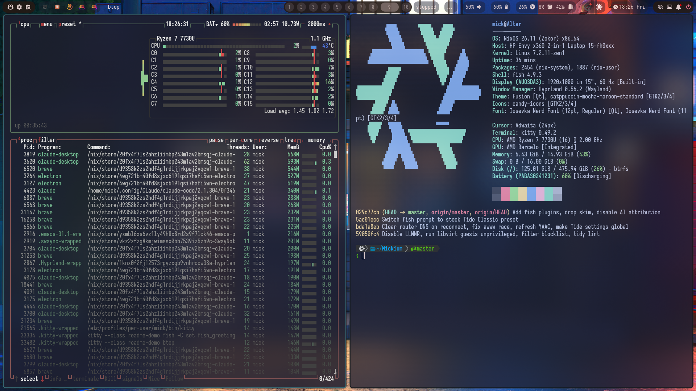
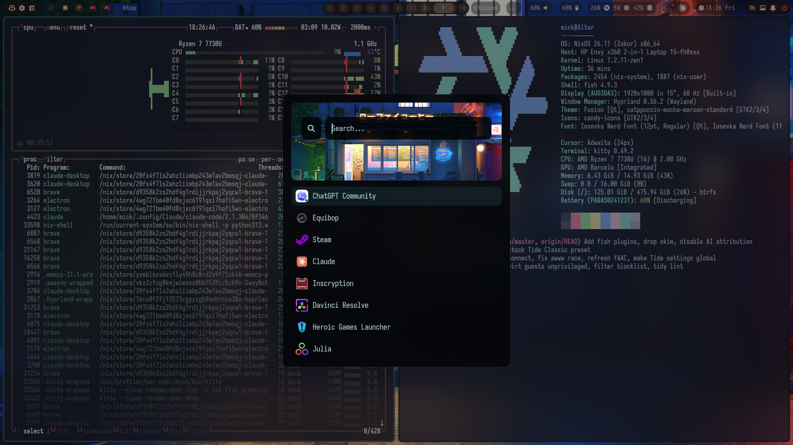

# Mickium

My personal, standalone NixOS flake. One repo builds the whole machine: the
base system, the Hyprland desktop, the Home Manager user environment, shell
and editor setup, apps, theming, networking, containers and per-host hardware.

Everything the flake needs lives in this repository. There is no external
dotfiles checkout.

> Working on this repo with an AI agent? Start with [`CLAUDE.md`](CLAUDE.md).
> For the detailed handoff map, see [`DESCRIPTION.MD`](DESCRIPTION.MD).

---

## Screenshots

Altar running the config: Hyprland with Waybar, Kitty with the Tide prompt and
fastfetch, and btop.



The Rofi launcher over the same workspace.



## Hosts

| Flake output | Machine | Notes |
| --- | --- | --- |
| `altar` | HP Envy x360 laptop | AMD Barcelo iGPU, Mesa OpenCL (Rusticl), battery UI in Waybar |
| `maxwell` | Desktop | Ryzen 5800X3D + Radeon 9070-class GPU, ROCm OpenCL |
| `wortox` | Portable system drive | Lives beside Ventoy, never touches EFI variables |

Flake outputs are **lowercase** (`#altar`), while hostnames are capitalised
(`Altar`). Always pass the output name explicitly.

## Quick Start

The checkout is expected at `/home/mick/Mickium`.

```sh
# Update inputs (run as yourself, not root)
nix flake update

# Build and activate the new system
doas nixos-rebuild switch --flake ~/Mickium#altar
```

Over SSH, use `boot` instead and reboot into the new generation (the previous
one stays in the boot menu):

```sh
doas nixos-rebuild boot --flake ~/Mickium#altar
reboot
```

A `switch` restarts services in the live session, and a dropped connection
mid-switch can leave the system half-activated, so only use it locally.

`system.autoUpgrade` does the same thing daily: it rebuilds from this
checkout with `operation = "boot"`, honouring the committed `flake.lock`.

## Repository Layout

```text
flake.nix       Inputs, dev shell, formatter, and host entrypoint
flake.lock      Pinned input revisions (committed on purpose)
hosts/          Host wiring (default.nix) and per-machine hardware configs
modules/        Shared NixOS system modules
home/           Home Manager configuration for user mick
docs/           Maintenance notes, cleanup rationale and screenshots
```

### System modules (`modules/`)

| File | What it covers |
| --- | --- |
| `core.nix` | User account, shell, locale, console, base packages |
| `bootloader.nix` | systemd-boot (5 second menu), Linux Zen kernel, xpadneo, network and kernel hardening sysctls |
| `desktop.nix` | Ly, Hyprland wrapper, PipeWire, Steam, TLP power management, lid and hibernate handling, Tailscale, graphics |
| `network.nix` | NetworkManager, DNS through `dnscrypt-proxy`, host blocking, Avahi, key-only SSH on port 2764, firewall |
| `security.nix` | doas, PAM U2F / YubiKey login, fail2ban, `dnscrypt-proxy`, GNOME Keyring |
| `bluetooth.nix` | BlueZ tuned for Xbox controllers |
| `containers.nix` | Podman (Docker-compatible), libvirt / QEMU / KVM with unprivileged guests |
| `nix.nix` | Nix settings, overlays, garbage collection, auto-upgrade |

### Home Manager (`home/`)

| Path | What it covers |
| --- | --- |
| `home/wayland/` | Hyprland, Waybar, Hyprlock, Hypridle, scripts |
| `home/programs/` | Desktop apps, media, games, browsers, theming, launchers, radio programmers (`radio.nix`) |
| `home/shell/` | Fish, git, CLI tools, Kitty, Emacs / Doom |
| `home/security/` | YubiKey / Yubico config |

## The Desktop

- **Compositor:** Hyprland, launched from the Ly display manager.
- **Workspaces:** [split-monitor-workspaces](https://github.com/zjeffer/split-monitor-workspaces)
  gives each monitor its own 1 to 10 workspace set.
- **Bar and launcher:** Waybar and Rofi.
- **Terminal:** Kitty.
- **Notifications:** SwayNC.
- **Theme:** Catppuccin Mocha, Iosevka Nerd Font, Candy icons.
- **Lock and idle:** Hyprlock and Hypridle. Closing the lid runs
  suspend-then-hibernate.

Some tools keep their native config language because it reads better that
way. Hyprland config lives in `home/wayland/hypr-config/`. It is still
installed by Home Manager, so edit the repo copy, not `~/.config/hypr`.

## Applications

| Area | Highlights |
| --- | --- |
| Browsers and chat | Brave, Equibop (Discord), Claude Desktop, Codex Desktop + CLI |
| Creative | Blender, Inkscape, Krita, DaVinci Resolve |
| Gaming | Steam, Heroic, Bolt Launcher, Prism Launcher, Wine |
| Media | MPD + `rmpc`, mpv, imv, yt-dlp, qpwgraph, pavucontrol |
| Radio and mesh | RT Systems programmers (Wine), Meshtastic, MeshCore CLI, direwolf, YAAC, cutecom |
| Devices | KDE Connect, Tailscale, Ventoy, Yubico Authenticator, scrcpy |
| Dev | Rider, Emacs / Doom, `gh`, lazygit, Podman |

## Shell and Editor

- **Shell:** Fish is the login and interactive shell, with the stock
  [Tide](https://github.com/IlanCosman/tide) prompt in its Classic style
  (two lines, Nerd Font icons). Plugins: `fzf.fish`, `sponge`, `autopair`,
  `done` and `puffer`; `nix-your-shell` keeps fish inside `nix develop`.
- **Editor:** Emacs with Doom. Doom is pinned in `flake.lock` and installed
  into a writable `~/.config/emacs`. The user config lives in
  `home/shell/doom/`. Home Manager runs `doom sync` on activation, and the
  Emacs daemon starts with the session.
- **Vim aliases:** `v`, `vi`, `vim` and `nvim` all open `emacs -nw`.

## Networking and Security

- **DNS:** every lookup goes through a local `dnscrypt-proxy` via
  systemd-resolved; NetworkManager does not hand DHCP DNS to resolved, and a
  dispatcher script clears any that leaks onto the Wi-Fi link.
- **SSH:** port 2764, key-only. fail2ban watches it.
- **Firewall:** default deny. KDE Connect ports are open on the Tailscale
  interface only. LLMNR is off.
- **Login:** PAM U2F / YubiKey, and GNOME Keyring unlocks with the login
  password (Brave and Claude Desktop use it through libsecret).
- **VMs:** libvirt guests run as an unprivileged user.

## Power and Hibernate

TLP manages power (full performance on AC, capped on battery). Altar has a
16 GiB btrfs swapfile with kernel resume configured, so the lid closing runs
suspend-then-hibernate and the machine can hibernate.

## Radio Programmers

The RT Systems programmers for the Kenwood TH-D75, BTECH DMR-6X2 Pro and
AnyTone AT-D578UV run under Wine from one prefix, with launchers, menu entries
and file associations from `home/programs/radio.nix`. The installers hang
under Wine, so the prefix was built from a Windows VM install; the recipe is in
[`DESCRIPTION.MD`](DESCRIPTION.MD).

## Development

The dev shell provides `alejandra`, `deadnix`, `statix`, `nil` and `git`.

```sh
nix fmt                         # format
nix develop -c deadnix .        # unused declarations
nix develop -c statix check .   # lints
nix flake check --show-trace    # evaluate everything
```

Maintenance rationale lives in [`docs/MAINTENANCE.md`](docs/MAINTENANCE.md).

## Fresh Install

1. Boot a NixOS installer and partition the disk (Altar uses BTRFS
   subvolumes).
2. Clone this repo to `/mnt/home/mick/Mickium` and check
   `hosts/<Host>/hardware-configuration.nix`.
3. Install the system:

   ```sh
   nixos-install --root /mnt --flake /mnt/home/mick/Mickium#altar --no-root-passwd
   ```

4. Log in as `mick` with the `initialPassword` from `modules/core.nix`, then
   run `passwd` right away.
5. Finish the Tailscale sign-in. The login URL is in
   `journalctl -u tailscaled-login -b`.
6. Pair security keys into `~/.config/Yubico/u2f_keys` before relying on
   security-key login.

For `#wortox`, replace `hosts/Wortox/hardware-configuration.nix` with one
generated on the target drive first. The committed file only exists to keep
the flake evaluable.

## Repo Rules

- Keep every required config file inside this repo.
- Commit `flake.lock`.
- Keep secrets, shell history, caches and build outputs out of Git.
- Prefer Home Manager and Nix modules when they stay readable. Keep native
  config files when translating them to Nix would make them worse.
